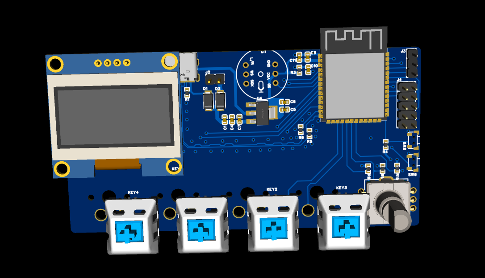
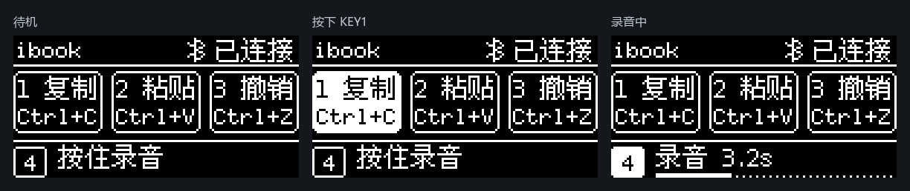

# ESP32-S3 蓝牙键盘

一个带 **4 个按键、EC11 旋钮、OLED 和 INMP441 麦克风**的蓝牙键盘。设备名为 `ibook Keyboard`。

电脑端提供统一的本地 Web 工作台，用于自定义快捷键、切换旋钮模式、管理语音输入和设置深度睡眠。
快捷键与旋钮操作由固件直接发送，保存后不需要工作台持续运行；语音识别和自动输入需要电脑端运行。

## 外观预览



PCB 三维预览。四个按键从左到右为 KEY4、KEY1、KEY2、KEY3，旋钮位于最右侧。

## 按键与旋钮

实体从左到右排列：**KEY4 → KEY1 → KEY2 → KEY3 → 旋钮**，屏幕位于左上方。

| 控件 | 出厂默认功能 | 配置方式 |
| --- | --- | --- |
| KEY4 | 按住录音，松开发送，单段最长 10 秒 | 网页点击 KEY4，设置语音接收、识别及自动输入 |
| KEY1 | Ctrl+C，复制 | 网页点击 KEY1，修改组合键和 OLED 名称 |
| KEY2 | Ctrl+V，粘贴 | 网页点击 KEY2，修改组合键和 OLED 名称 |
| KEY3 | Ctrl+Z，撤销 | 网页点击 KEY3，修改组合键和 OLED 名称 |
| 旋钮：页面滚动模式 | 顺时针向下、逆时针向上，按下 Enter | 网页点击旋钮，选择模式并保存 |
| 旋钮：电脑音量模式 | 顺时针增大、逆时针减小，按下切换静音 | 同上 |

上述快捷键是出厂默认值，设备已有的用户配置会覆盖它们。按住旋钮不会重复切换静音。
KEY4 的录音由实体按钮控制，网页和电脑全局热键不负责开始录音。

### OLED 显示示意



帧缓冲示意展示待机、按键按下和录音状态；实际名称与快捷键随用户配置更新。
更多显示说明见 [OLED 文档](docs/oled-display.md)。

## 首次使用

### 1. 烧录与配对

使用 PlatformIO 打开项目。直接通过板上 USB-C 烧录和查看日志，选择 **`esp32-s3-usb-debug`**：

```powershell
pio run -e esp32-s3-usb-debug
pio run -e esp32-s3-usb-debug -t upload
```

烧录前关闭串口监视器或串口助手，避免占用端口。在 Windows 蓝牙设置中配对 `ibook Keyboard`。
从未带网页配置、滚轮或音量控制的旧固件升级时，删除旧配对后重新添加，刷新 HID/GATT 缓存。
若已使用带音量控制的固件，仅升级深睡功能通常不需要重新配对。

| 编译环境 | 日志接口 |
| --- | --- |
| `esp32-s3-usb-debug` | J1 / USB-C 原生 USB，适合直接连接电脑调试 |
| `esp32-s3-devkitc-1`（默认） | J3 / UART0，RX=GPIO44、TX=GPIO43，115200 波特率 |

### 2. 准备电脑环境

在项目根目录执行，已有 `.venv` 时跳过第一行：

```powershell
python -m venv .venv
.venv/Scripts/python.exe -m pip install -r pc/requirements-asr.txt
```

电脑端日常使用 Windows、Python 3.11 或更新版本，以及可用的蓝牙适配器。
只配置按键或保存录音、不做语音识别时，可安装 `pc/requirements.txt`。

### 3. 启动统一工作台

双击 **[pc/start.cmd](pc/start.cmd)**，浏览器打开 <http://127.0.0.1:8787>，点击“连接键盘”。

- 点击 KEY1～KEY3：右侧显示对应快捷键配置，编辑后点击“保存到键盘”。
- 点击 KEY4：右侧显示语音设置和最近识别结果。
- 点击旋钮：选择页面滚动或电脑音量模式，保存到键盘。
- 点击页面顶部“深度睡眠”：修改闲置时间或关闭自动深睡。

一次只展开所选控件的配置，切换控件会保留未保存的表单内容。快捷键名称最多 2 个常用汉字或 4 个英文字符。

| 日常入口 | 作用 |
| --- | --- |
| [pc/start.cmd](pc/start.cmd) | 启动工作台并打开网页；重复启动会打开已有服务 |
| [pc/status.cmd](pc/status.cmd) | 查看工作台、蓝牙和语音状态 |
| [pc/stop.cmd](pc/stop.cmd) | 停止工作台和语音接收 |

网页底部“退出服务”也会停止工作台。仅关闭浏览器标签不会停止后台。

## 语音输入

1. 网页连接键盘，点击 KEY4。
2. 勾选“启用语音接收”和“识别为文字”，按需勾选“自动输入当前窗口”，应用设置。
3. 等待状态显示“等待 KEY4”，点击记事本等目标输入框。
4. 按住实体 KEY4 说话，松开发送；电脑接收完整音频后保存 WAV、识别中文并保存 TXT。
5. 开启自动输入时，文字会输入识别完成时的焦点窗口，不自动按 Enter。

录音使用板上的 INMP441，不使用电脑麦克风。先录后传，每段最多 10 秒。
默认使用本地 `tiny` 模型，可选 `base` 或 `small`；首次使用可能需要联网下载模型，识别时音频不上传云端。
网页显示本次运行最近 8 条结果，可手动复制。语音引擎运行在受管理的独立子进程中，避免原生库异常退出时关闭整个工作台。

## 深度睡眠

默认**闲置 10 分钟进入深睡**，可在网页设置 1～120 分钟或关闭。没有独立熄屏计时，屏幕只在真正进入深睡前关闭。

- 按键、旋钮操作及录音会重置闲置时间；录音、传输、配置事务或按键未松开期间不睡眠。
- 深睡会断开蓝牙。按 KEY1～KEY4 或按下旋钮唤醒，第一次按下只唤醒。
- 全部松开、等待蓝牙重连后，再正常操作。单纯旋转旋钮不唤醒深睡。
- USB 调试串口在深睡时可能消失，唤醒或复位后再烧录、监视。

快捷键、旋钮模式和深睡时间保存在键盘 NVS 中，断电保留。详细行为与实物验证步骤见 [深睡说明](docs/deep-sleep.md)。

## 接线与供电

引脚以芯片 GPIO 编号为准，统一定义在 [include/board_config.h](include/board_config.h)。

| 功能 | GPIO |
| --- | --- |
| KEY4 / 录音键 | 7，按下接 GND |
| KEY1 / KEY2 / KEY3 | 8 / 9 / 10，按下接 GND |
| EC11 A / B / 按压开关 | 11 / 12 / 13 |
| OLED SDA / SCL | 15 / 16 |
| INMP441 BCLK / WS / SD | 4 / 5 / 6，左声道 |
| 原生 USB D− / D+ | 19 / 20 |

OLED 默认按 SSD1306 128×64 驱动，自动查找 0x3C/0x3D。
接线依据为 [原始网表](hardware/Netlist_Schematic1_2026-10-22.tel)，完整说明见 [GPIO 对照](docs/gpio-map.md)。

当前板子由 USB 5V 或 J2 的 `EXT_5V` 供电，网表没有锂电池充电管理电路。使用电池时需另配匹配的充电、保护和供电模块。
**真实电量检测尚未实现**：当前 BLE 电池服务固定上报 100%，不能作为剩余电量依据。已讨论的 ADC 分压方案尚未接入固件与界面。

## 文件与目录

```text
src/                 固件实现：蓝牙、按键、旋钮、录音、屏幕和深睡
include/             GPIO、参数、协议与模块接口
pc/
  start.cmd          日常启动
  status.cmd         查看状态
  stop.cmd           停止服务
  web_config.py      本地 HTTP 服务与后台事件循环
  keyboard_app.py    共用 BLE 连接、语音会话和重连
  keymap_*.py        配置校验、事务写入与回读
  voice_*.py         音频接收、协议、模型与诊断基础设施
  speech_process.py  语音子进程管理
  windows_input.py   Windows Unicode 文字输入
  web/               网页界面
  tools/             旧版独立接收器诊断工具，日常不需要运行
  tests/             自动化测试与 C++ 模拟硬件
  runtime/           本地设置、设备地址和日志
  recordings/        录音 WAV 与识别 TXT
hardware/            原始网表
docs/                接线、功能、协议和开发说明
```

`.venv/` 是电脑运行环境，`.pio/asr_models/` 是语音模型缓存；不要作为普通编译缓存删除。
`.pio/build/` 保存固件产物，`.pio/libdeps/` 保存显示库依赖。清理编译中间文件后，下次构建会重新生成它们。

## 开发与验证

```powershell
.venv/Scripts/python.exe -m pip install -r pc/requirements-dev.txt
.venv/Scripts/python.exe -m unittest discover -s pc/tests -v
node --test pc/web/tests/model.test.js
```

固件模拟测试需要 `g++`，缺少时对应测试会跳过。测试不会向电脑输入真实按键，也不会写入已配对键盘。
编译和自动化测试不能代替实物的录音质量、旋钮方向、深睡唤醒、蓝牙恢复及整板功耗验证。

## 详细说明

- [PC 工作台使用](pc/README.md) · [Web 配置与接口](docs/web-config.md)
- [实际接线与 GPIO](docs/gpio-map.md) · [语音输入](docs/voice-input.md)
- [旋钮与音量模式](docs/encoder.md) · [OLED 显示](docs/oled-display.md)
- [深度睡眠](docs/deep-sleep.md) · [语音协议](docs/voice-protocol.md)
- [开发、烧录与诊断](docs/development.md)
